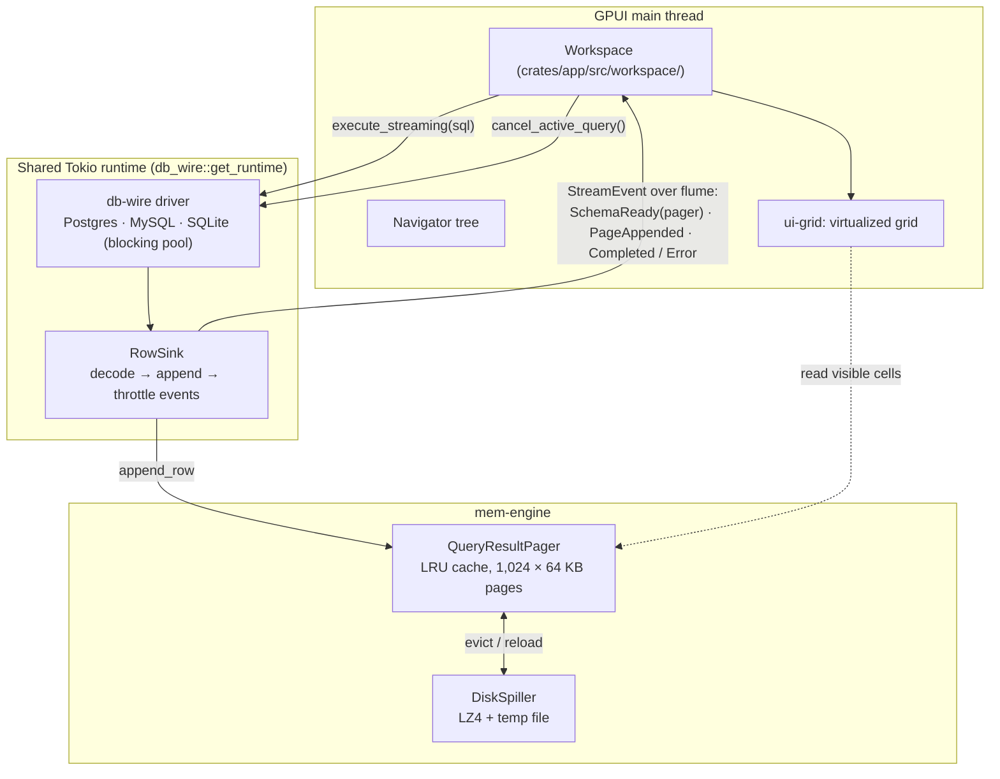

# FastDB ⚡

> **A native Rust database client — aiming to replace JVM/JDBC tools like DBeaver**
> *No JVM · No JDBC · GPU-rendered UI (GPUI) · Bounded memory for huge result sets*

[](https://github.com/Matrix-I/fastdb/actions/workflows/ci.yml)
[](https://www.rust-lang.org)
[](https://github.com/zed-industries/zed)
[](ci/)

FastDB is a database client built from scratch in Rust. It talks to databases through native async drivers and vendor ODBC clients, renders its UI on the GPU with [GPUI](https://github.com/zed-industries/zed) (Metal on macOS, Vulkan on Linux), and keeps query results in a paged, disk-spilling memory engine so a million-row result does not need a million-row heap.

> **Status: early prototype.** Browsing tables, streaming their data and running free-form SQL from script tabs works against PostgreSQL, MySQL and SQLite. Several other features listed under [Not built yet](#-not-built-yet) exist only as tested library code or not at all. The performance numbers below are **targets, not measurements**.

---

## 🎯 Goals

FastDB is aiming for these targets against a typical JVM client. They remain aspirational; the [regression protocol](benchmarks/README.md) and [local measurements](benchmarks/VALIDATION.md) track measured behavior and acceptance budgets separately.

| Metric | DBeaver (Java / JDBC) | FastDB target |
| :--- | :--- | :--- |
| Cold start | 4.5 s – 12 s | < 120 ms |
| Idle RAM | 600 MB – 1.2 GB | < 35 MB |
| 1M rows × 20 cols query | 2.5 GB+ (risk of OOM) | ~80 MB, bounded by disk spill |
| Time to first row | 300 ms – 2,000 ms | < 10 ms |
| Grid scrolling | 15 – 45 FPS (GC pauses) | 120 FPS |
| Package size | ~130 MB (bundled JRE) | ~12 MB |

What exists today that these targets build on: a paged result store with an LRU cache and LZ4 disk spill, a virtualized grid that only lays out visible rows, and drivers that stream rows into the store as they arrive.

---

## ✅ What works today

### Connections
- **PostgreSQL** (`tokio-postgres`), **MySQL / MariaDB** (`mysql_async`) and **SQLite** (`rusqlite`, bundled). MariaDB has its own provider preset, saved identity and MySQL-compatible SQL handling.
- **Db2 for LUW**, **Oracle** and **SQL Server** support connections, SQL execution and streamed results through installed vendor ODBC drivers. The driver manager is bundled. See [provider setup and live tests](docs/PROVIDERS.md).
- TCP, or automatic local **Unix domain socket** discovery for PostgreSQL (`/tmp/.s.PGSQL.*`, `/var/run/postgresql`, `/run/postgresql`) and MySQL.
- Saved connections with create / edit / delete / test, plus quick presets per driver.
- **TLS for PostgreSQL and MySQL**: enable TLS in the connection dialog to require encryption and verify the server certificate and hostname. Leave the root CA path empty for system trust, or supply a PEM/DER root CA certificate for a private CA. TLS uses TCP even when Unix socket discovery is enabled. Existing connections default to TLS disabled.
- Saved connection passwords use the OS keychain (macOS Keychain / Linux Secret Service). Existing plaintext passwords migrate automatically after successful keychain storage; config files retain only credential references. Keychain/save failures are shown in the workspace with a retry action.

### Database navigator
- DBeaver-style tree: connection → databases → schemas → tables → columns, constraints, foreign keys, indexes.
- Schema metadata (tables, columns, primary keys, constraints, indexes) is loaded in bulk when you connect.

### Table tabs
- The tab strip scrolls horizontally with a mouse wheel or trackpad and brings newly opened or selected tabs into view.
- Reopening a table in the same connection and schema selects its existing tab and preserves its results and staged edits.
- **Data**:
  - Results **stream into the grid**: the grid appears as soon as the columns are known and grows as row batches arrive.
  - While a query runs, the execute button becomes **Cancel**. Cancellation uses the PostgreSQL cancel token, `KILL QUERY` on MySQL, and `sqlite3_interrupt` on SQLite.
  - Filter bar for `WHERE` / `ORDER BY` / `GROUP BY` fragments, a row limit (default 200), and a grid or plain-text view.
  - **Criteria filters and history**: Criteria opens a searchable column picker with multiple AND/OR conditions, comparison/LIKE/NULL operators, literal values and optional ordering. Apply replaces the filter text and executes once; Cancel leaves it unchanged. Text values are quoted/encoded by provider (PostgreSQL E literals; MySQL/MariaDB UTF-8 hex conversion independent of backslash mode). Per-tab back/forward restores executed filter/order/fetch-size states, including structured criteria; new execution replaces the forward branch. History retains up to 100 states within an approximate 1 MiB budget plus the current state. Save/Cancel staged row edits before changing filters or history. Expand hides navigator/value panes while preserving their widths; Restore/Escape returns them. SQL preview is cached, bounded on screen and copyable in full; long input rendering preserves full Unicode values and selection.

  - Virtualized rows, auto-fit column widths, drag-to-resize, and double-click to auto-fit. The vertical scrollbar follows the actual grid bounds and reaches the bottom with the last row.
  - Cell/range selection by dragging the left mouse button across cells or using Shift-click, with `Cmd/Ctrl + C` for TSV. Releasing the mouse keeps the selected rectangle; double-click still edits a cell. Right-click a data cell for **Copy (TSV)**, **Copy as CSV** or **Copy as SQL INSERT**, in both table and script results. Right-click inside a selected rectangle to keep it; outside selects the clicked cell. Copies use displayed values, including staged edits and inserted rows. CSV has no header and writes NULL as an empty field; SQL includes only selected columns, uses provider-specific identifier/literal quoting and emits one INSERT per selected row. Table targets retain schema/name; script results use `query_result` (rename before executing). As with export, SQL uses text representations rather than a schema/binary backup. Menu copies run in the background with footer status and a 16 MiB output limit; failures leave the clipboard unchanged. Larger selections can use file export after saving/cancelling staged edits.
  - Inline cell edits, row insertion, duplication and deletion, with Save / Cancel and undo / redo. Save generates SQL and applies the changes in one transaction.
  - **Export CSV / Export SQL** in the result footer saves all currently loaded rows from table or script results through a native save dialog. Fetch more rows before exporting if needed. Save or cancel staged edits first. Export runs in the background with status/errors in the footer; an existing destination is replaced only after the complete file is ready. CSV includes column headers, with NULL written as an empty field. SQL writes one INSERT per row with provider-specific quoting, using the table's schema/name or `query_result` for script results (rename that target before importing). Values use the result's text representation; this is a data export, not a schema or binary-type backup.
- **Properties**: a scrollable detail pane with visible horizontal/vertical scrollbars for every section; stable column widths and expanding detail rows keep metadata readable. The Columns list uses single-line clipped cells with explicit line height to prevent long native type names wrapping into adjacent rows. Columns (type, nullability, default, collation, PK), constraints, indexes, and a DDL pane with a fixed **Copy DDL** toolbar. In DDL, `Cmd/Ctrl + A` highlights all SQL and `Cmd/Ctrl + C` copies it without line numbers; Escape or clicking the SQL clears selection. PostgreSQL generates executable structural DDL for ordinary/partitioned tables and views: native column types/collations/defaults, identity/generated columns, owned serial sequences, constraints, indexes, comments, storage options, ownership, explicit grants, RLS/policies, triggers, rules and extended statistics. Partition DDL attaches to an existing parent. Referenced schemas, roles, types, functions and tables must already exist; data and current sequence values are excluded. Inheritance/typed/temporary/foreign tables are explicitly unavailable; invalid indexes are identified and omitted. Other providers retain a partial metadata preview. PostgreSQL also shows native type precision/length, column comments, owner, OID, effective tablespace, table comment, RLS flags, persistence, partition key, estimated rows, table/index/total bytes and vacuum/analyze timestamps. Index methods, ordered expressions/INCLUDE columns, uniqueness, validity, predicates and full constraint/foreign-key definitions come from PostgreSQL catalogs. Metadata refreshes with the connection's schema refresh; unsupported or unknown values remain unavailable.
- **PostgreSQL catalog sections**: Properties loads Dependencies, References, Partitions, Triggers, Rules, Policies and Permissions asynchronously. Direct dependency/dependent rows retain relation navigation; parent/child partition links include bounds; triggers/rules expose native definitions; policies include roles, expressions and RLS flags. Permissions shows stored/default table and direct column ACLs, not effective privileges through role memberships or RLS. Copy source and relation navigation are available where applicable. Empty, failed, disconnected and provider-unsupported states are distinct, with retry and refresh. Catalog reads are read-only and independent of SQL-tab transactions; manual GUI acceptance is pending.

- **Diagram**: a connection-scoped multi-table ER view with qualified table names, PK/FK column badges and directed FK column links for PostgreSQL, MySQL/MariaDB and SQLite. Composite keys, self references and cross-schema targets retain their column mappings. Wheel/trackpad scrolling works on both axes with visible horizontal/vertical scrollbar tracks; middle-drag pans. Native macOS trackpad pinch, Cmd/Ctrl + trackpad/wheel, Cmd/Ctrl + plus/minus (0 resets), and the Zoom/Fit/Reset/Focus table controls navigate the layout, and double-clicking a table header opens its data tab on the owning connection. Cards widen for long column names/types, and clicking a column shows all available column metadata in the footer. Click a relationship row to highlight its edge and read the full constraint/column mapping in the footer. Metadata/layout is cached on schema refresh and only visible table cards are rendered; unsupported/failed FK metadata is shown explicitly. Diagram export and manual table positioning remain unavailable.

- **PostgreSQL column editor**: double-click a column in Properties/Navigator, or select it and press Enter, to open its own draft tab. Edit the name, native type (with catalog type suggestions and optional explicit USING expression), nullable flag, default SQL expression or multiline comment. Default removal is distinct from SQL NULL. Save/Cmd+S opens a quoted DDL preview; Persist applies one dedicated transaction and reads the catalog back, while Revert discards the local draft. Stable table OID/attribute identity and a locked snapshot check detect concurrent changes. Close, metadata refresh, disconnect, delete-connection and Quit guard dirty drafts with Save/Discard/Cancel. Connection/commit uncertainty requires Refresh before retrying. Owning connection caches refresh after success; old table grids retain staged edits but require reload before Save. Identity/generated columns, inheritance/partition tables, collation/storage/permissions editing and non-PostgreSQL mutations remain explicitly read-only/unsupported. Interactive GUI acceptance is pending the user's test.

### SQL editor
- **Shared text editing**: SQL, connection fields (including passwords), filter/fetch size, script search/rename and inline cell editors share command, clipboard and mouse selection handling. Esc clears the selection without moving the caret or changing text (press Esc again to dismiss a dialog or cancel a cell edit); Shift-click extends or shrinks from the original anchor; double-click selects a line (the full value in a one-line field). Copy/cut use the selected text and do nothing without a selection. Paste replaces the selection; one-line fields flatten pasted line breaks and numeric fields keep only digits.
- **PostgreSQL query plans**: Explain/Analyze use the same text, spacing and hover styling as the other SQL toolbar actions. **Explain** plans the statement under the caret; **Analyze (executes SQL)** runs it with `EXPLAIN (ANALYZE, BUFFERS, FORMAT JSON)`. The collapsible tree shows operators, costs, row estimates, actual per-loop timings/rows and buffer usage. Switch to raw JSON for the full output; each result tab preserves its plan view. Explain and Analyze use the SQL tab's persistent session, including temporary tables, session settings and uncommitted changes. Analyze writes participate in the tab's open transaction; SQL errors retain the session for Rollback or ROLLBACK TO, while Cancel rolls back and closes it. Analyze executes the original statement, including writes and function side effects; Cancel uses the existing query cancellation. Other providers do not yet have a visual plan viewer.
- Scripts are `.sql` files saved per connection under `<config dir>/scripts/<connection id>/Script-<n>.sql` (on macOS `~/Library/Application Support/com.fastdb.FastDB/scripts`), saved atomically in the background after a short pause in typing. Run, tab close and Quit wait for pending saves; the global Quit menu/shortcut defers workspace access until GPUI finishes event dispatch; a save failure keeps the tab open and shows an error.
- `Cmd + ]`, the **+ SQL** button or **SQL Editor** in a connection's right-click menu reopens the connection's latest script, or creates `Script-1` when it has none. When the latest script is already open, a **Choose SQL script** dialog lists the connection's scripts by time with a search box, a **New script** button and **Show scripts for all connections**.
- Table and script tabs keep their connection identity, results and staged edits when switching connections. Editing a connection preset does not change an open session's SQL dialect.
- A script tab runs on its own connection: selecting it switches the active connection, and the toolbar shows which one.
- Table names completed after `FROM` / `JOIN` get an alias (`"featureFlag" f`), and `f.` completes that table's columns.
- **Editor viewport**: long SQL lines and multi-line scripts scroll horizontally/vertically inside the editor pane, with visible scrollbar tracks. Moving the caret reveals it on both axes; select-all keeps the viewport steady.
- **Selection and clipboard**: double-click SQL text to select the entire line (including its line break); dragging after a double-click extends by whole lines. `Cmd/Ctrl + A` highlights the entire script clearly; drag to select text; hold Shift and click to extend or shrink the selection from its original anchor (including after a double-click), or use Shift + navigation keys; `Cmd/Ctrl + A/C/X/V` selects all, copies, cuts or pastes. Typing replaces the selection; undo/redo restores edits.
- `Cmd/Ctrl + Enter` runs the selected SQL, or the statement under the caret; its rows stream into the grid below the editor.
- **Run script** (`Cmd/Ctrl + Shift + Enter`) executes semicolon-delimited statements sequentially, exactly once, stopping on the first error or Cancel. Each statement streams its full result into the paged/spilling store, retaining the latest 20 results.
  - **PostgreSQL** keeps one dedicated physical session per SQL tab across Execute and Run script, separate from browsing/metadata and row-edit Save. Temporary tables and session settings survive successive runs. **Begin / Commit / Rollback** toolbar actions and SQL transaction controls can span runs; SAVEPOINT, ROLLBACK TO [SAVEPOINT] name and RELEASE [SAVEPOINT] name support partial rollback. The footer reports transaction state after acknowledged controls. BEGIN options, chaining and prepared transactions remain unsupported; no implicit transaction is added.
  - PostgreSQL SQL errors stop remaining statements and retain the tab session, allowing ROLLBACK TO or Rollback to recover a failed transaction. Cancel rolls back and closes the session with bounded cleanup. Closing a tab or disconnecting closes its socket and PostgreSQL rolls back uncommitted work. Earlier committed/autocommit writes remain applied. Session loss is terminal with no automatic reconnect, replay or COMMIT retry; disconnect/reconnect opens a fresh session on the next execution. A lost COMMIT acknowledgement can mean an uncertain commit outcome.
  - Other providers retain ordinary-script execution and reject explicit transactions; pooled providers do not guarantee session state across statements. Unquoted procedural blocks and vendor batch directives (`GO`, `DELIMITER`) remain unsupported. Quoted literals/comments and PostgreSQL dollar-quoted bodies preserve embedded semicolons. Backslash string escapes and MySQL hash/executable comments remain rejected because their parsing depends on session settings.
- **Result tabs** retain the latest 20 statement results per script, including each result's SQL, grid, selection, fetch state and errors. Switch results after execution completes; older results are released automatically.
- **Format** (`Cmd/Ctrl + Shift + F`) lays out the selection, or the whole script, as one undoable edit. Formatting preserves token/literal/comment bytes and adds line breaks at top-level clauses; it does not rewrite dialect-specific SQL.
- **History** lists up to 100 unique recent executions per connection, newest first; click an entry to insert it at the caret or replace selected text without executing it. History persists under `<config dir>/query-history` as plaintext SQL; queries larger than 64 KiB are omitted.
- **Rename** changes the current script's `.sql` filename without overwriting another file. **Delete** asks for confirmation and moves the file into its connection folder's `.trash`; restore it manually by moving the `.sql` file back. Both wait for queued autosaves; input is paused during the move.
- Plain `SELECT` / `WITH` statements without their own `LIMIT` are fetched in chunks of the fetch size, like table data; other statements run as written.
- Schema-aware completion of keywords, functions, tables and `table.` columns, accepted with `Tab` or `Enter`.
- The error of a failed statement is shown above the result, in script and table tabs.

### Type handling
- **PostgreSQL**: every column is decoded from the binary wire format. Covered types include integers, floats, `NUMERIC` (exact), `TEXT`, `UUID`, `JSON(B)`, `BYTEA`, dates and times (including `TIMETZ`, `INTERVAL` and ±infinity), `INET`, `CIDR`, `MACADDR`, `MONEY`, `OID`, `"char"`, enums, domains and N-dimensional arrays. A type FastDB does not recognize is shown as text or as a hex literal; it is never shown as `NULL`.
- **MySQL**: result columns are typed from the wire column type. **SQLite**: result columns are typed from the declared column type.

### Memory engine
- Rows are stored in 64 KB slotted pages, with a null bitmap and a cell offset table per row for O(1) cell access.
- An LRU cache keeps up to 1,024 pages (~64 MB) in memory. Evicted pages are LZ4-compressed into a temporary spill file and paged back in on demand.
- The page currently being filled is shared copy-on-write, so reading it does not copy 64 KB per cell.
- Spill files go to `/var/tmp/fastdb` on Linux, to avoid a RAM-backed `/tmp`, and to `$TMPDIR/fastdb` on macOS.

### Software updates
- **About FastDB**: Open the application menu's About dialog to view the app icon, name and version; close it with **Close**, `Esc` or `Cmd/Ctrl + W`.
- **In-app update checks**: Queries GitHub Releases for new FastDB versions and compares semantic versioning. If the API is unavailable (including 403/rate limits), follows the public latest-release redirect as a fallback. When only the version is available, use **View Release** for notes and downloads.
- **Automatic startup check**: Throttled background check runs silently once every 24 hours on app launch.
- **Manual check via menu**: Check anytime via the application menu `FastDB -> Check for Updates...`.
- **Native macOS confirmation**: When already up to date, shows a system alert with the app icon, FastDB name, current version and **OK**, matching Litty's update confirmation.
- About and update status dialogs use compact, content-sized layouts; update dialogs with release notes have extra width for readability.
- **In-app download & progress**: View markdown release notes directly in a native modal, download update packages with real-time progress bars, and launch the installer (.dmg on macOS, packages on Linux).
- **Top bar indicator badge**: When a new release is available, a subtle notification pill appears in the window top bar for 1-click access.

### Keyboard shortcuts

| macOS | Linux | Action |
| :--- | :--- | :--- |
| `Cmd + Enter` | `Ctrl + Enter` | Run the active tab's query (in a SQL script: selection or statement under the caret) |
| `Cmd + Shift + Enter` | `Ctrl + Shift + Enter` | Run the whole SQL script sequentially |
| `Cmd + Shift + F` | `Ctrl + Shift + F` | Format selected SQL or the whole script |
| `Shift` + navigation / click | same | Extend editor text selection |
| `Cmd + ]` | `Ctrl + ]` | Open the latest SQL script of the connection (or choose one) |
| `←` `→` `↑` `↓`, `Home`, `End` | same | Move the caret in the SQL editor |
| `Alt + ←/→` | `Alt + ←/→` | Move the caret by word in the SQL editor |
| `Cmd + ←/→`, `Cmd + ↑/↓` | `Ctrl + ←/→`, `Ctrl + ↑/↓` | Move to the line start/end, or the script start/end |
| `Tab` / `Enter` (completion open) | same | Accept the selected completion (`Esc` closes the list) |
| `Enter` (in filter bar) | `Enter` (in filter bar) | Apply the filter and re-run |
| `Esc` (in filter bar) | `Esc` (in filter bar) | Leave the filter bar |
| `Cmd + W` | `Ctrl + W` | Close the active tab |
| `Cmd + Q` | `Ctrl + Q` | Quit |
| `Cmd + A / C / X / V` | `Ctrl + A / C / X / V` | Select all, copy, cut, paste in text fields |

---

## 🚧 Not built yet

The [audited roadmap](docs/ROADMAP.md) separates working paths, partial features, UI-only controls and missing workflows. Major gaps include:

- **Additional Properties mutations.** Virtual keys/relationships are not implemented. PostgreSQL catalog sections are read-only; other providers explicitly show unsupported sections.
- **Advanced column editing.** PostgreSQL ordinary-column drafts, preview/Persist and Revert are implemented; identity/generated/storage/collation/permissions transitions and other-provider mutation support remain open. The [GUI/business analysis](docs/DBEAVER_WORKFLOWS.md) specifies this workflow and broader screen coverage.
- **Core DBeaver workflows.** ER diagram export/manual positioning, object create/alter/drop UI, richer object navigation/search, SQL find/replace and parameter prompts, data import/transfer, structured value editing, backup/restore, session/lock monitoring and workspace restoration remain open. See the roadmap for scope and acceptance criteria.
- **Advanced script execution.** Transaction chaining, pinned sessions/transaction scripts for other providers, and vendor procedural/batch syntax remain unsupported. PostgreSQL supports persistent tab sessions, transaction controls and SQL savepoints.
- **SSH tunnels.** `ssh_tunnel.rs` is a stub: it does not forward traffic or verify host keys.
- **Additional metadata for other providers.** PostgreSQL Properties has catalog metadata and statistics; other providers label unsupported fields as unavailable. PostgreSQL row counts are estimates, and partition-parent sizes are unavailable rather than a misleading zero or a sum of partitions. PostgreSQL DDL uses catalog definitions for tables and views (see provider documentation for scope); other providers retain a partial preview.
- **Light theme.** A light palette exists in `ui-core`, but there is no way to switch to it.
- **Performance target validation.** The desktop regression suite measures startup, RSS, a million-row SQLite stream, scrolling and release executable size; cold-cache startup, live-provider latency and the original target claims still need separate measurements.

---

## 🏛️ Architecture



- Connection sessions own their provider, schema cache and metadata. Table/script tabs and asynchronous query/Save operations carry stable connection and tab identities, including the original cancellation driver.
- Script snapshots are written by one background queue using atomic replacement; cursor blinking and query progress update the result pane independently. Software Update is a separate GPUI entity with its own state and tasks.
- Every driver future runs on one shared multi-threaded Tokio runtime (`db_wire::run_on_shared_runtime`). Sockets and pool tasks therefore never depend on a short-lived caller runtime.
- A query produces an ordered event stream:
  1. `SchemaReady(pager)`: the driver owns the result pager and hands it to the UI.
  2. Throttled `PageAppended` batches, at most once per frame or on each page rollover.
  3. `Completed` or `Error`.
- The UI routes events to tabs by a stable tab id. While a query is running, a second run is refused rather than racing the cancel.

### Workspace crates

| Crate | Kind | Responsibility | State |
| :--- | :--- | :--- | :--- |
| `xtask` | developer tool | Native benchmark runner and regression checker (`cargo xtask`) | Used |
| `app` | binary | Window, workspace UI, connection management, query orchestration | Used |
| `platform-hal` | library | Paths, spill directory, Unix socket discovery, keychain, keymap helpers | Used |
| `mem-engine` | library | Slotted pages, LRU pager, LZ4 disk spill | Used |
| `db-wire` | library | Drivers, streaming, cancellation, CSV/SQL export, SSH (stub) | Used (SSH unused) |
| `sql-intel` | library | Tree-sitter SQL parsing, schema cache, completion | Used |
| `ui-core` | library | Theme and shared actions | Used |
| `ui-editor` | library | Rope buffer and SQL editor view | Used |
| `ui-grid` | library | Virtualized grid, selection, changeset | Used, including selection and editing |

---

## 🛠️ Getting started

### Prerequisites

- **Rust** stable, with `cargo` (see `rust-toolchain.toml`). All workspace crates use Rust edition **2024**.
- **macOS** with Xcode command line tools.
- **Linux** system libraries (Debian/Ubuntu):
  ```bash
  sudo apt-get install -y build-essential pkg-config libdbus-1-dev libxcb1-dev libxkbcommon-dev libxkbcommon-x11-dev libwayland-dev libfontconfig1-dev libasound2-dev libvulkan-dev libssl-dev
  ```

### Install the macOS preview

Download the Apple Silicon DMG or ZIP from [GitHub Releases](https://github.com/Matrix-I/fastdb/releases/latest) and copy FastDB.app into `/Applications`.
The v0.1.0 release is an early preview for macOS Apple Silicon; Linux packages are not included.
The app is ad-hoc signed and not notarized. If Gatekeeper blocks it, run:

```bash
xattr -dr com.apple.quarantine /Applications/FastDB.app
```

The published v0.1.0 preview stores saved passwords in plaintext JSON. Current source builds use the OS keychain and migrate existing passwords. Performance figures above remain unmeasured targets.

### Run

```bash
git clone https://github.com/Matrix-I/fastdb.git
cd fastdb
cargo run --release -p fastdb-app
```

For an isolated development profile, set `FASTDB_CONFIG_DIR=/tmp/fastdb-smoke` before launching. This keeps saved connections, scripts and update preferences separate from your normal profile.

Saved connections are written to `connections.json` in the user config directory (`~/Library/Application Support/com.fastdb.FastDB/` on macOS, `~/.config/fastdb/` on Linux), so they survive rebuilds and launches from Finder. A `.fastdb_config.json` left in the working directory by older builds is migrated on first launch and removed after a successful save. Passwords are stored under the `com.fastdb.credentials` keychain service, keyed by connection ID; JSON contains a `keychain_password` reference flag, never a new plaintext password. Migration retains the source file if secure storage fails.

An unlocked macOS Keychain or Linux Secret Service is required to save passwords. If a saved secret is missing or inaccessible, its reference is preserved and connecting requires re-entering the password or unlocking the keychain and restarting. Clearing a password or deleting a connection removes its stored secret; failed deletions are retried on the next save or startup. Failed saves show a workspace banner with **Retry saving connections** and block Quit until a successful retry. Ad-hoc signed macOS updates may prompt again for keychain access; cross-update access still needs release smoke testing.

---

## 🧪 Testing

```bash
# Unit tests and SQLite driver tests (live-database tests skip themselves)
cargo test --workspace
```

The PostgreSQL and MySQL integration tests run when a server is configured through environment variables. They cover binary decoding against the server's own text output, incremental streaming, cancellation, and connections that outlive the caller's runtime.

| Variable | Default | Purpose |
| :--- | :--- | :--- |
| `FASTDB_TEST_PG_PORT` | (unset: skip) | PostgreSQL port; enables `crates/db-wire/tests/postgres_test.rs` |
| `FASTDB_TEST_PG_HOST` / `_USER` | `127.0.0.1` / `postgres` | PostgreSQL host and user (trust auth expected) |
| `FASTDB_TEST_MYSQL_PORT` | (unset: skip) | MySQL port; enables `crates/db-wire/tests/mysql_test.rs` |
| `FASTDB_TEST_MYSQL_HOST` / `_USER` / `_PASSWORD` / `_DATABASE` | `127.0.0.1` / `root` / none / `mysql` | MySQL connection |
| `FASTDB_TEST_KEYCHAIN` | unset | Set to `1` to run the native credential-store round trip with an isolated test service |
| `FASTDB_REQUIRE_DB_TESTS` | unset | When set, a missing port fails the tests instead of skipping them (used in CI) |

For example, with Docker:

```bash
docker run -d --name fastdb-pg -e POSTGRES_HOST_AUTH_METHOD=trust -p 5432:5432 postgres:16
```

```bash
docker run -d --name fastdb-mysql -e MYSQL_ROOT_PASSWORD=fastdb -p 3306:3306 mysql:8.4
```

```bash
FASTDB_TEST_PG_PORT=5432 FASTDB_TEST_MYSQL_PORT=3306 FASTDB_TEST_MYSQL_PASSWORD=fastdb cargo test -p db-wire
```

### TLS integration tests

With Docker and OpenSSL available, run `./ci/test-tls.sh`. It creates disposable PostgreSQL and MySQL servers with a private test CA, checks encrypted sessions, rejects untrusted certificates and incorrect hostnames, verifies PostgreSQL TLS cancellation, and checks that PostgreSQL refuses plaintext fallback. The containers and temporary certificates are removed on exit. CI runs this after the regular driver tests.

### Performance regression checks

Build the release app, then run the fixed desktop workload on a visible desktop:

```bash
cargo build --locked --release -p fastdb-app
cargo xtask benchmark --output benchmarks/results/baseline.json --display-id built-in-60hz-2x
# After a change and rebuild, compare on the same machine/display/toolchain:
cargo xtask benchmark --output benchmarks/results/candidate.json --display-id built-in-60hz-2x \
  --baseline benchmarks/results/baseline.json
```

The suite measures process startup, idle/peak RSS, streaming 1,000,000 rows x 20
columns through SQLite and the spilling pager, real grid scrolling p95/stutters,
and release executable size. It discards a warmup launch and checks median results
from five processes against absolute budgets and optional baseline regression
limits. Reports retain per-run metrics, frame intervals and build/host provenance.
See [benchmark protocol, thresholds and CI setup](benchmarks/README.md). The original
performance goals above remain aspirational; these initial budgets are deliberately
broader. The manual desktop workflow requires a dedicated display host.

### Continuous integration

[`.github/workflows/ci.yml`](.github/workflows/ci.yml) runs three jobs:

- The engine and driver crates against `postgres:16` and `mysql:8.4` service containers, with `FASTDB_REQUIRE_DB_TESTS` set.
- A full workspace build and test on macOS.
- A Linux build of the app.

---

## 📦 Packaging

For local macOS builds, use the root script (same workflow as Litty):

```bash
./bundle_macos.sh               # Build for this Mac and install if ~/Applications exists
./bundle_macos.sh --no-install  # Package only
```

Outputs go to `dist/`: `FastDB.app`, `FastDB.dmg` (with an Applications shortcut),
`FastDB-macos.zip`, and `fastdb-macos`, plus architecture-suffixed binary/ZIP copies.
The app is signed ad-hoc for local use; distribution signing and notarization are separate steps.
Both macOS packaging scripts use `diskutil image create from` when available,
with an `hdiutil` fallback for older macOS versions.

Packaging scripts live in [`ci/`](ci/):

```bash
./ci/build-macos.sh   # dist/macos/FastDB.app and a .dmg
```

```bash
./ci/build-linux.sh   # dist/linux/*.deb and an AppImage
```

---

## 🗺️ Roadmap

See the **[full roadmap and source audit](docs/ROADMAP.md)** for UI-only findings, provider limits, prioritized missing DBeaver workflows and completion criteria. Checked items below denote the stated implementation scope, not full DBeaver parity or live acceptance on every provider.

- [x] Workspace structure and GPUI window
- [x] Slotted pages, LRU pager and LZ4 disk spill
- [x] PostgreSQL, MySQL and SQLite drivers with streaming results and cancellation
- [x] Complete PostgreSQL binary decoding (no false `NULL`s)
- [x] Basic table navigator, data tabs and supported read-only Properties
- [ ] Complete Properties readers and wire or disable no-op toolbar controls
- [ ] Multi-table ER diagram with relationships and navigation (current Diagram is a single-box preview)
- [x] Virtualized grid with auto-fit and resizable columns
- [x] CI with live PostgreSQL and MySQL
- [x] SQL editor tabs with statement-at-cursor execution and autocompletion
- [x] Per-connection SQL script files, autosave and script chooser
- [x] In-app update checks, release notes and installer download
- [x] Grid selection, TSV copy, and inline editing with `UPDATE` generation
- [x] Row insertion, duplication and deletion with transactional Save / Cancel
- [x] Keychain-backed connection passwords and migration from plaintext config
- [x] SQL editor extras: sequential ordinary-script execution, multiple result tabs, text selection/copy, script rename/delete, query history and whitespace formatting
- [x] Persistent PostgreSQL SQL-tab sessions, Begin/Commit/Rollback controls and SQL savepoints
- [ ] Pinned scripts for other providers and provider-specific procedural/batch syntax
- [x] Grid selection copy as TSV, CSV and provider-aware SQL `INSERT`
- [x] Export to CSV / SQL from the UI
- [x] PostgreSQL table statistics and catalog metadata in Properties
- [ ] Rich table statistics and metadata for other providers
- [x] PostgreSQL catalog-derived structural DDL for ordinary/partitioned tables and views
- [ ] DDL for PostgreSQL inheritance/typed/temporary/foreign tables and complete DDL for other providers
- [x] TLS for PostgreSQL and MySQL with certificate/hostname verification and optional root CA
- [x] Provider picker with PostgreSQL, Db2 for LUW, MariaDB, MySQL, Oracle, SQL Server and SQLite
- [x] MariaDB provider preset using the MySQL-compatible driver
- [x] Db2 for LUW, Oracle and SQL Server connections and SQL execution through vendor ODBC drivers
- [x] Local container validation of Oracle and SQL Server connections, SQL and row-edit transactions
- [ ] Live Db2 validation and broader ODBC platform/TLS coverage (deferred; PostgreSQL is the priority)
- [ ] SSH bastion / jump host tunneling
- [x] Reproducible desktop regression benchmarks with a native Rust runner, versioned workloads, absolute budgets and same-host baseline thresholds
- [ ] Validate original performance targets with cold-cache and live-provider measurements
- [x] PostgreSQL visual query plan (`EXPLAIN ANALYZE`) viewer
- [ ] Data diff and schema comparison
- [ ] Theme switching and persisted workspace/preferences
- [ ] Object explorer/search and create/alter/drop workflows
- [ ] SQL find/replace, parameters, external files and execution log
- [ ] Advanced grid operations, related-row navigation and structured value editing
- [ ] Data import, full-source export and database-to-database transfer
- [ ] Roles/permissions, routine editing, backup/restore and session/lock monitoring
- [ ] Saved tasks and optional scheduling

---

## 📄 License

MIT. See [LICENSE](LICENSE).
