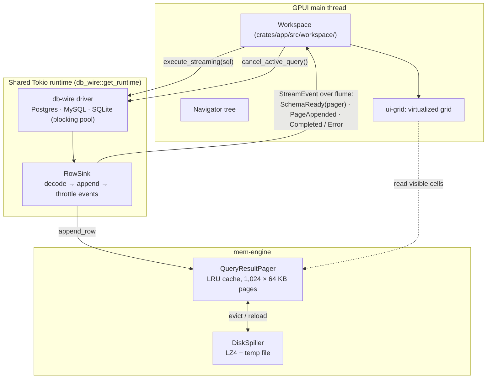

# FastDB ⚡

> **A native, pure-Rust database client — aiming to replace JVM/JDBC tools like DBeaver**
> *No JVM · No JDBC · GPU-rendered UI (GPUI) · Bounded memory for huge result sets*

[](https://github.com/Matrix-I/fastdb/actions/workflows/ci.yml)
[](https://www.rust-lang.org)
[](https://github.com/zed-industries/zed)
[](ci/)

FastDB is a database client built from scratch in Rust. It talks to databases through native async drivers, renders its UI on the GPU with [GPUI](https://github.com/zed-industries/zed) (Metal on macOS, Vulkan on Linux), and keeps query results in a paged, disk-spilling memory engine so a million-row result does not need a million-row heap.

> **Status: early prototype.** Browsing tables, streaming their data and running free-form SQL from script tabs works against PostgreSQL, MySQL and SQLite. Several other features listed under [Not built yet](#-not-built-yet) exist only as tested library code or not at all. The performance numbers below are **targets, not measurements**.

---

## 🎯 Goals

FastDB is aiming for these targets against a typical JVM client. None of them has been benchmarked yet.

| Metric | DBeaver (Java / JDBC) | FastDB target |
| :--- | :--- | :--- |
| Cold start | 4.5 s – 12 s | < 120 ms |
| Idle RAM | 600 MB – 1.2 GB | < 35 MB |
| 1M rows × 20 cols query | 2.5 GB+ (risk of OOM) | ~80 MB, bounded by disk spill |
| Time to first row | 300 ms – 2,000 ms | < 10 ms |
| Grid scrolling | 15 – 45 FPS (GC pauses) | 120 FPS |
| Package size | ~130 MB (bundled JRE) | ~12 MB |

What exists today that these targets build on: a paged result store with an LRU cache and LZ4 disk spill, a virtualized grid that only lays out visible rows, and drivers that stream rows into the store as they arrive.

---

## ✅ What works today

### Connections
- **PostgreSQL** (`tokio-postgres`), **MySQL / MariaDB** (`mysql_async`) and **SQLite** (`rusqlite`, bundled).
- TCP, or automatic local **Unix domain socket** discovery for PostgreSQL (`/tmp/.s.PGSQL.*`, `/var/run/postgresql`, `/run/postgresql`) and MySQL.
- Saved connections with create / edit / delete / test, plus quick presets per driver.
- **Passwords are stored in the OS keychain** (macOS Keychain, Linux Secret Service), never in the config file. Passwords left in an older plaintext config are migrated to the keychain on startup.

### Database navigator
- DBeaver-style tree: connection → databases → schemas → tables → columns, constraints, foreign keys, indexes.
- Schema metadata (tables, columns, primary keys, constraints, indexes) is loaded in bulk when you connect.

### Table tabs
- **Data**:
  - Results **stream into the grid**: the grid appears as soon as the columns are known and grows as row batches arrive.
  - While a query runs, the execute button becomes **Cancel**. Cancellation uses the PostgreSQL cancel token, `KILL QUERY` on MySQL, and `sqlite3_interrupt` on SQLite.
  - Filter bar for `WHERE` / `ORDER BY` / `GROUP BY` fragments, a row limit (default 200), and a grid or plain-text view.
  - Virtualized rows, auto-fit column widths, drag-to-resize, and double-click to auto-fit.
- **Properties**: columns (type, nullability, default, collation, PK), constraints, indexes, and generated DDL.
- **Diagram**: a simple entity box listing the table's columns.

### SQL editor
- Open a **SQL script** tab with `Cmd + ]`, the **+ SQL** button in the tab bar, or **SQL Editor** in a connection's right-click menu.
- `Cmd + Enter` runs the statement under the caret; its rows stream into the grid below the editor.
- Plain `SELECT` / `WITH` statements without their own `LIMIT` are fetched in chunks of the fetch size, like table data; other statements run as written.
- Schema-aware completion of keywords, functions, tables and `table.` columns, accepted with `Tab` or `Enter`.
- The error of a failed statement is shown above the result, in script and table tabs.

### Type handling
- **PostgreSQL**: every column is decoded from the binary wire format. Covered types include integers, floats, `NUMERIC` (exact), `TEXT`, `UUID`, `JSON(B)`, `BYTEA`, dates and times (including `TIMETZ`, `INTERVAL` and ±infinity), `INET`, `CIDR`, `MACADDR`, `MONEY`, `OID`, `"char"`, enums, domains and N-dimensional arrays. A type FastDB does not recognize is shown as text or as a hex literal; it is never shown as `NULL`.
- **MySQL**: result columns are typed from the wire column type. **SQLite**: result columns are typed from the declared column type.

### Memory engine
- Rows are stored in 64 KB slotted pages, with a null bitmap and a cell offset table per row for O(1) cell access.
- An LRU cache keeps up to 1,024 pages (~64 MB) in memory. Evicted pages are LZ4-compressed into a temporary spill file and paged back in on demand.
- The page currently being filled is shared copy-on-write, so reading it does not copy 64 KB per cell.
- Spill files go to `/var/tmp/fastdb` on Linux, to avoid a RAM-backed `/tmp`, and to `$TMPDIR/fastdb` on macOS.

### Keyboard shortcuts

| macOS | Linux | Action |
| :--- | :--- | :--- |
| `Cmd + Enter` | `Ctrl + Enter` | Run the active tab's query (in a SQL script: the statement under the caret) |
| `Cmd + ]` | `Ctrl + ]` | Open a new SQL script |
| `←` `→` `↑` `↓`, `Home`, `End` | same | Move the caret in the SQL editor |
| `Alt + ←/→` | `Alt + ←/→` | Move the caret by word in the SQL editor |
| `Cmd + ←/→`, `Cmd + ↑/↓` | `Ctrl + ←/→`, `Ctrl + ↑/↓` | Move to the line start/end, or the script start/end |
| `Tab` / `Enter` (completion open) | same | Accept the selected completion (`Esc` closes the list) |
| `Enter` (in filter bar) | `Enter` (in filter bar) | Apply the filter and re-run |
| `Esc` (in filter bar) | `Esc` (in filter bar) | Leave the filter bar |
| `Cmd + W` | `Ctrl + W` | Close the active tab |
| `Cmd + Q` | `Ctrl + Q` | Quit |
| `Cmd + A / C / X / V` | `Ctrl + A / C / X / V` | Select all, copy, cut, paste in text fields |

---

## 🚧 Not built yet

These are goals of the project, but they are not available in the app today:

- **SQL editor extras.** Running a whole script, several result tabs, selection and copy inside the editor, query history and SQL formatting are not built yet.
- **Grid selection, copy and inline editing.** Range selection with TSV / CSV / SQL `INSERT` copy, and inline edits that generate `UPDATE` statements, exist in `ui-grid` with tests, but they are not connected to mouse or keyboard input.
- **Export from the UI.** Streaming CSV and SQL `INSERT` export exists in `db-wire::export`, but no menu or button calls it.
- **SSH tunnels.** `ssh_tunnel.rs` is a stub: it does not forward traffic or verify host keys.
- **TLS.** PostgreSQL connects without TLS, so servers that require SSL are not supported yet.
- **Placeholder metadata.** Some Properties fields (object ID, owner, tablespace, and the statistics table) show placeholder values rather than data read from the database. The status bar's "120 FPS" label is static text.
- **Light theme.** A light palette exists in `ui-core`, but there is no way to switch to it.
- **Benchmarks.** None of the numbers under [Goals](#-goals) has been measured.

---

## 🏛️ Architecture



- Every driver future runs on one shared multi-threaded Tokio runtime (`db_wire::run_on_shared_runtime`). Sockets and pool tasks therefore never depend on a short-lived caller runtime.
- A query produces an ordered event stream:
  1. `SchemaReady(pager)`: the driver owns the result pager and hands it to the UI.
  2. Throttled `PageAppended` batches, at most once per frame or on each page rollover.
  3. `Completed` or `Error`.
- The UI routes events to tabs by a stable tab id. While a query is running, a second run is refused rather than racing the cancel.

### Workspace crates

| Crate | Kind | Responsibility | State |
| :--- | :--- | :--- | :--- |
| `app` | binary | Window, workspace UI, connection management, query orchestration | Used |
| `platform-hal` | library | Paths, spill directory, Unix socket discovery, keychain, keymap helpers | Used |
| `mem-engine` | library | Slotted pages, LRU pager, LZ4 disk spill | Used |
| `db-wire` | library | Drivers, streaming, cancellation, CSV/SQL export, SSH (stub) | Used (export and SSH unused) |
| `sql-intel` | library | Tree-sitter SQL parsing, schema cache, completion | Used |
| `ui-core` | library | Theme and shared actions | Used |
| `ui-editor` | library | Rope buffer and SQL editor view | Used |
| `ui-grid` | library | Virtualized grid, selection, changeset | Grid used; selection and editing not wired |

---

## 🛠️ Getting started

### Prerequisites

- **Rust** stable, with `cargo` (see `rust-toolchain.toml`).
- **macOS** with Xcode command line tools.
- **Linux** system libraries (Debian/Ubuntu):
  ```bash
  sudo apt-get install -y build-essential pkg-config libdbus-1-dev libxcb1-dev libxkbcommon-dev libxkbcommon-x11-dev libwayland-dev libfontconfig1-dev libasound2-dev libvulkan-dev libssl-dev
  ```

### Run

```bash
git clone https://github.com/Matrix-I/fastdb.git
cd fastdb
cargo run --release -p fastdb-app
```

Saved connections are written to `connections.json` in the user config directory (`~/Library/Application Support/com.fastdb.FastDB/` on macOS, `~/.config/fastdb/` on Linux), so they survive rebuilds and launches from Finder. A `.fastdb_config.json` left in the working directory by older builds is moved there on first launch. Passwords are currently stored in that file in plain text.

---

## 🧪 Testing

```bash
# Unit tests and SQLite driver tests (live-database tests skip themselves)
cargo test --workspace
```

The PostgreSQL and MySQL integration tests run when a server is configured through environment variables. They cover binary decoding against the server's own text output, incremental streaming, cancellation, and connections that outlive the caller's runtime.

| Variable | Default | Purpose |
| :--- | :--- | :--- |
| `FASTDB_TEST_PG_PORT` | (unset: skip) | PostgreSQL port; enables `crates/db-wire/tests/postgres_test.rs` |
| `FASTDB_TEST_PG_HOST` / `_USER` | `127.0.0.1` / `postgres` | PostgreSQL host and user (trust auth expected) |
| `FASTDB_TEST_MYSQL_PORT` | (unset: skip) | MySQL port; enables `crates/db-wire/tests/mysql_test.rs` |
| `FASTDB_TEST_MYSQL_HOST` / `_USER` / `_PASSWORD` / `_DATABASE` | `127.0.0.1` / `root` / none / `mysql` | MySQL connection |
| `FASTDB_REQUIRE_DB_TESTS` | unset | When set, a missing port fails the tests instead of skipping them (used in CI) |

For example, with Docker:

```bash
docker run -d --name fastdb-pg -e POSTGRES_HOST_AUTH_METHOD=trust -p 5432:5432 postgres:16
```

```bash
docker run -d --name fastdb-mysql -e MYSQL_ROOT_PASSWORD=fastdb -p 3306:3306 mysql:8.4
```

```bash
FASTDB_TEST_PG_PORT=5432 FASTDB_TEST_MYSQL_PORT=3306 FASTDB_TEST_MYSQL_PASSWORD=fastdb cargo test -p db-wire
```

### Continuous integration

[`.github/workflows/ci.yml`](.github/workflows/ci.yml) runs three jobs:

- The engine and driver crates against `postgres:16` and `mysql:8.4` service containers, with `FASTDB_REQUIRE_DB_TESTS` set.
- A full workspace build and test on macOS.
- A Linux build of the app.

---

## 📦 Packaging

Packaging scripts live in [`ci/`](ci/):

```bash
./ci/build-macos.sh   # dist/macos/FastDB.app and a .dmg
```

```bash
./ci/build-linux.sh   # dist/linux/*.deb and an AppImage
```

---

## 🗺️ Roadmap

- [x] Workspace structure and GPUI window
- [x] Slotted pages, LRU pager and LZ4 disk spill
- [x] PostgreSQL, MySQL and SQLite drivers with streaming results and cancellation
- [x] Complete PostgreSQL binary decoding (no false `NULL`s)
- [x] DBeaver-style navigator and table tabs (data, properties, diagram)
- [x] Virtualized grid with auto-fit and resizable columns
- [x] Keychain-backed password storage
- [x] CI with live PostgreSQL and MySQL
- [ ] SQL editor tabs with statement-at-cursor execution and autocompletion
- [ ] Grid selection, copy, and inline editing with `UPDATE` generation
- [ ] Export to CSV / SQL from the UI
- [ ] Real table statistics and metadata in Properties
- [ ] TLS for PostgreSQL and MySQL
- [ ] SSH bastion / jump host tunneling
- [ ] Benchmarks for the goals above
- [ ] Visual query plan (`EXPLAIN ANALYZE`) viewer
- [ ] Data diff and schema comparison
- [ ] Theme switching

---

## 📄 License

MIT, as declared in `Cargo.toml`. A `LICENSE` file has not been added yet.
