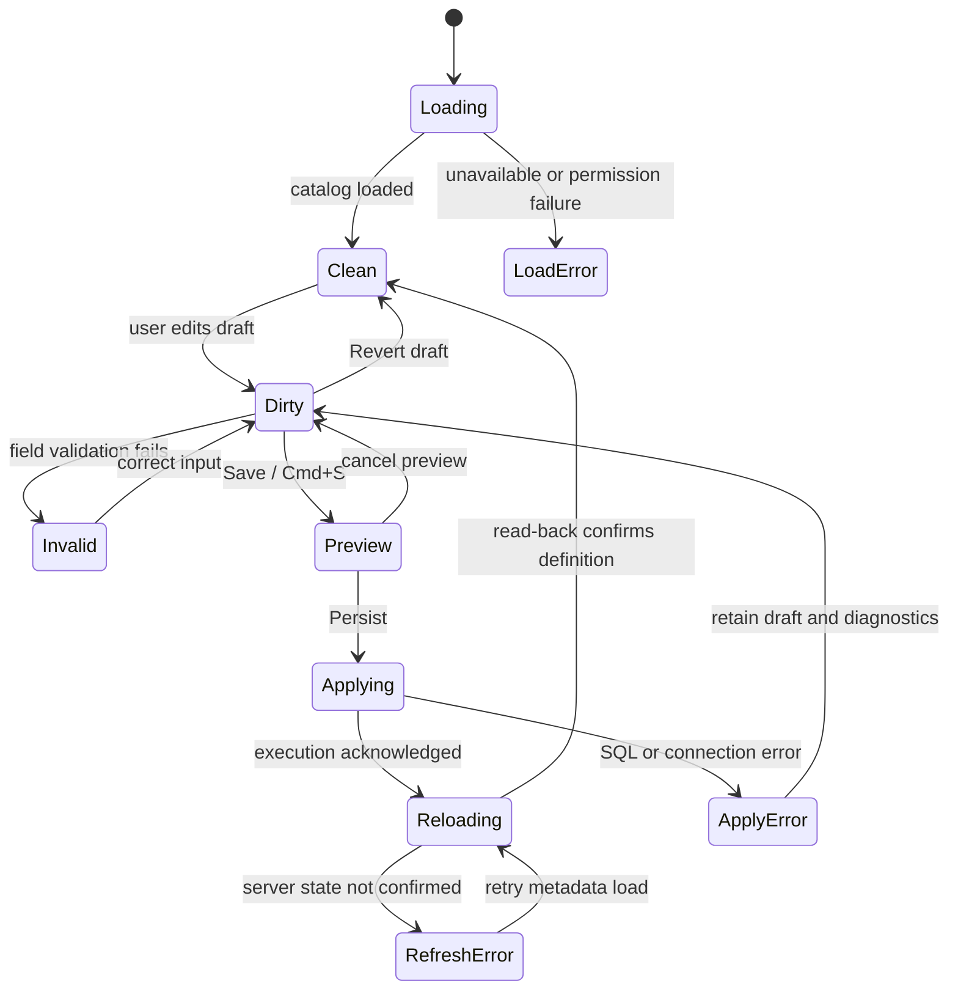

# DBeaver GUI and business workflow analysis

Date: 2026-11-02. Purpose: define the behavior behind FastDB's screens, rather than reproduce DBeaver's appearance without its actions.

## Evidence and coverage

This analysis combines two user-supplied screenshots, the FastDB working tree and official DBeaver documentation. Direct inspection of the installed DBeaver was attempted but Computer Use permission was unavailable. **This is a screen-family inventory and workflow specification, not a claim that every DBeaver screen, dialog, edition or provider has been manually exercised.** Exact field editability, shortcut behavior and provider-specific dialogs still need desktop acceptance.

The screenshot of the `host` column is evidence of its visible form and controls, not proof that every displayed field is editable. The numbered fields and disabled buttons must not be reproduced as active controls without provider support. Examples below use synthetic names; connection names and role lists from the screenshot are not required fixtures.

Documentation-backed behavior is linked in each relevant section. Acceptance rules and architecture recommendations are proposed **FastDB behavior**, not undocumented assertions about DBeaver internals.

## The central business model

DBeaver opens an object editor from navigation and uses different pages for properties, data and relationships. Sub-objects such as columns are objects in their own right. The parent table's Columns list is an entry point into an attribute editor, not a replacement for that editor. [Object editor](https://dbeaver.com/docs/dbeaver/Database-Object-Editor/)

FastDB needs four distinct kinds of state:

| State | Example | Persistence boundary |
| :--- | :--- | :--- |
| Local document | SQL script text | Save/autosave writes a file; does not execute SQL. |
| Metadata draft | Rename a column or change its default | Save previews and applies provider DDL; refresh reads the catalog. |
| Data draft | Change a cell or insert a row | Save generates DML against a known target/key. |
| Database transaction | Executed but uncommitted SQL | Commit/Rollback acts on the owning physical session. |

A single generic Save action cannot silently treat these as equivalent. Revert discards an unapplied draft; Rollback affects a transaction; refreshing metadata reloads server state. Their target and effect must be clear. DBeaver separately documents metadata persistence and SQL transaction modes. [Properties toolbar](https://dbeaver.com/docs/dbeaver/Properties-Editor/), [transaction modes](https://dbeaver.com/docs/dbeaver/Auto-and-Manual-Commit-Modes/)

## Screenshot findings and current FastDB gaps

### Columns list rendering

The supplied FastDB screenshot shows `character varying (50)`, `(200)`, `(1000)` and `timestamp without time zone` wrapping across neighboring rows. The source in `properties/columns.rs` allowed wrapping in fixed-width cells. A minimum row height alone did not provide a reliable one-line layout.

The immediate patch makes Columns cells single-line and clipped, gives rows an explicit line height/padding, and retains horizontal scrolling. Longer values need a full-value viewer/editor or tooltip in the subsequent interaction milestone; clipping is not a substitute for access to the complete value. Visual confirmation at the user's display scale is still required.

Further semantics found in the same source:

- Rows currently have no double-click/open-object action.
- Identity is rendered as an empty string, not loaded column identity metadata.
- Missing collation is displayed as `default`; unknown metadata must eventually be distinguished from an actual default collation.
- Collation was styled as a link with no navigation action. The immediate patch removes that pointer/link affordance.
- `#` is computed from the list index. An editor must load the catalog ordinal; it is not an arbitrary editable position field.
- A rendered `[v]`/`[ ]` is a read-only nullability display, not a functioning checkbox.

### Column editor shown by `host`

The screenshot shows a separate column tab, a Properties header form, Permissions/Source pages and Refresh/Save/Revert actions. FastDB has table/script tabs and read-only Columns metadata, but no equivalent attribute-editing workflow. Adding a double-click handler that only opens a form would still leave this feature incomplete.

The requested navigation contract is:

1. Double-click a column row, or use Open/Enter from the table's Columns list or navigator.
2. Open or select a column tab identified by connection + database + schema + parent table + stable column identity.
3. Load the actual definition and provider capabilities; expose applicable fields with explicit read-only/unsupported states.
4. Edit a local draft, show dirty state and validation, and enable Save/Revert only when appropriate.
5. Save produces a reviewed DDL change set; execution updates the database and then reloads the definition and dependent UI.

DBeaver's documented create-column flow also stages column definitions before persistence; its create dialog should not be confused with the existing-column tab in the screenshot. [Creating columns](https://dbeaver.com/docs/dbeaver/Creating-columns/)

## Column editor: proposed PostgreSQL-first contract

### Fields and meaning

| Field | Proposed behavior | Validation / caveat |
| :--- | :--- | :--- |
| Name | Editable, staged rename | Quote identifiers; retain original identity while the name is a draft; reject empty/duplicate names. |
| Data type | Catalog-backed type picker plus explicit native declaration | Preserve length/precision/scale, schema-qualified/domain/enum/array types. Never derive DDL from a lossy grid display type. |
| Type conversion | Explicit conversion expression when needed | Show risk of conversion failure/data loss/table rewrite; do not invent a cast or drop/recreate the column automatically. |
| Not Null | Editable only for supported relations | Existing NULLs may reject the change; preserve draft and show the server error. |
| Default | SQL-expression editor with separate set/remove state | Empty input, SQL NULL and removal are distinct operations. Preserve expression syntax, not a quoted string literal. |
| Comment | Multiline text; explicit clear | Quote text safely; preserve Unicode/newlines. |
| Identity | Catalog value and provider/version-aware choices | Existing identity, serial ownership and a new identity request have different semantics. Unsupported transitions are read-only. |
| Generated | Show expression and kind; gate editing by server capability | Do not imply arbitrary generated-expression changes are legal on every server version. |
| Collation | Catalog-backed selection/details | Only applicable types; unknown is not the same as database default. Explain whether a type alteration is required. |
| Storage | Applicable PostgreSQL storage choices | Use catalog capability and type rules; not a generic text field for every provider. |
| Ordinal (`#`) | Read-only catalog position | No promise of physical column reorder. |
| Local / inherited | Read-only origin with parent navigation | Inherited/partitioned columns need parent-aware restrictions. |
| Permissions | Role selection and explicit column privileges | Distinguish direct grants, inherited/effective permissions and grant option; deny unsupported actions clearly. |
| Source | Definition/change-SQL view with copy | Clearly distinguish existing definition from pending ALTER statements; editing preview text must not desynchronize the draft. |

These are implementation requirements, not a completed PostgreSQL DDL specification. Before implementation, verify legal transitions against the supported PostgreSQL versions and add live fixtures. Permission edits are a separate capability from ordinary column edits.

### Draft, Save and Revert lifecycle

Proposed rules:

- Capture an original catalog snapshot and draft separately. Switching tabs/connections must not mutate either target.
- Compare the original definition to the server before applying. Concurrent changes require reload/review, not silent overwrite.
- Build SQL in dependency order from typed changes; a rename must not invalidate subsequent statements targeting that column.
- Use a dedicated schema-change execution context. Do not accidentally commit an unrelated SQL tab transaction.
- Use provider transactional DDL where supported; otherwise report which statements applied. A lost acknowledgement means uncertain outcome, requiring read-back before any retry.
- On success refresh table Properties, navigator, completion cache, DDL and diagram metadata. Notify stale result grids when a schema change affects their columns.
- Revert discards the local draft. After persistence, an inverse migration is a new operation, not a local undo.
- Close/refresh/disconnect/Quit with a dirty metadata draft offers Save, Discard or Cancel. Save errors keep the draft open.

### Acceptance fixtures

Use an isolated database with `sample.customer(host varchar(50), note text, created_at timestamp without time zone)` and fixtures for nullable values, quoted identifiers, Unicode comments, domains/enums, identity/generated columns and inherited/partitioned relations.

- Open the same column twice: one tab, same draft. Open a same-named column on another connection: a different tab.
- Rename + change default/comment: preview targets correctly; persist and reconnect to verify.
- Set Not Null on NULL-containing data: visible error; no false success; draft retained.
- Change type with an invalid conversion: no implicit data destruction; show the failing operation.
- Concurrent rename/drop/type change: conflict before applying or clear server error, never act on a different object.
- Permission-denied, disconnected, timeout, cancel and lost acknowledgement: keep truthful state and safe retry behavior.
- Revert and close-cancel leave the database unchanged. Save-readback refreshes all relevant views.

## Screen-family coverage and business acceptance

The inventory below covers major desktop workflow families. Each row specifies what FastDB must deliver beyond drawing the screen. Rows are proposed parity targets unless the evidence column says screenshot/documented; they are not all available in FastDB. Per-provider and commercial-edition extensions require separate validation.

| Screen family / entry | User intent and meaningful controls | Required outcome / edge cases | Evidence / roadmap |
| :--- | :--- | :--- | :--- |
| Application shell, menu, tab strip | Open/select/close tabs; Quit; panel layout; contextual shortcuts | Focus routes actions correctly; dirty work handled; Quit exits after acknowledged saves | Screenshot; P0-08, P1-10 |
| New/Edit Connection | Pick provider, endpoint, credentials, Test and Save | Test uses the draft; saved configuration and active sessions remain distinct; actionable network/auth errors | [Connection configuration](https://dbeaver.com/docs/dbeaver/Configure-Connection/); P1-09 |
| Network/auth pages | SSH, TLS, proxy, authentication variants | Real transport/authentication configuration, host/cert validation and lifecycle cleanup | Documentation index; P1-09; provider-specific follow-up |
| Connection initialization | Default database/schema, transaction mode, session settings | Settings reach the correct physical session; visible active context | Transaction documentation; P1-05 |
| Navigator and object filter | Explore typed objects, filter, refresh, reveal active object | Lazy metadata, stable identity, permissions/empty states; no connection leakage | [Navigator](https://dbeaver.com/docs/dbeaver/Database-Navigator/); P1-01 |
| Database/schema editor | Inspect owner/settings and child objects; create/open objects | Catalog-backed properties, scoped actions and parent breadcrumbs | Object-editor docs; P1-01/02 |
| Table Properties overview | Read/edit table-level metadata; switch sub-entity lists | Draft state, capability-aware fields and persistent DDL changes | Properties docs; P1-02 |
| Columns list + attribute tab | Select/open/create/rename/alter/drop column | Full lifecycle above, not inline row data editing | Both screenshots, create-column docs; P0-06/07 |
| Constraints editor | PK/unique/check definition; ordered columns and options | Preview and apply correct constraint; invalid data/dependencies reported | [Constraints](https://dbeaver.com/docs/dbeaver/Implementing-Constraints/); P1-02 |
| Foreign-key editor | Map local/referenced column pairs; update/delete actions | Preserve composite ordering and target identity; refresh references/diagram | Object-editor model; P1-02; detailed dialog inspection pending |
| Index editor | Ordered keys/expressions, uniqueness, method and provider options | Create/drop/rebuild semantics and unsupported options explicit | P1-02; detailed provider dialogs pending |
| Views/materialized views | Read/edit source; inspect columns; refresh data where supported | Source applies to the intended object; dependency and refresh errors visible | P1-01/02, P2-01 |
| Sequences, routines and types | Inspect definitions; edit source/options; invoke with parameters | Native type semantics, parameter/result handling and privileges | P2-01; provider-specific screens pending |
| Triggers/rules/policies | Inspect definition and enabled state; edit/enable/disable | Actual catalog changes, object dependencies and error feedback | P0-02, P2-01; provider-specific screens pending |
| Partitions/dependencies/references | Understand containment and impact; navigate related objects | Correct incoming/outgoing direction, bounds and parent targets | P0-02; [Partitions](https://dbeaver.com/docs/dbeaver/How-to-work-with-database-Partitions/) |
| Permissions and roles | Select subject, inspect grants, change privileges | Correct object/column scope and grant option; effective vs explicit grants | `host` screenshot; P2-01; execution not observed |
| DDL/Source + Persist Changes | Inspect/copy definition; review pending SQL; Persist/cancel | Preview represents exact draft; success only after execution/read-back | Properties/create-column docs; P0-07 |
| Table Data / SQL results | Fetch, filter, sort, select, copy, edit rows | Correct row identity, paging, draft DML, Save/Cancel and provider errors | [Data Editor](https://dbeaver.com/docs/dbeaver/Data-Editor/); P1-06 |
| Criteria/filter history | Build predicates/order, back/forward, reset | SQL and visible rows correspond; distinguish server filtering from local loaded-row search | P0-03 |
| Value / record / references panels | Inspect/edit one value, whole record, related rows | Correct type/NULL/binary handling and target navigation; no truncation on save | Data-editor documentation index; P1-06/07 |
| Metadata/grouping/calc/result-detail panels | Explain column origin; aggregate selections/results | State whether computation covers fetched rows or full query; cancellation | P2-07; detailed panel inspection pending |
| SQL editor / parameters / variables | Edit, complete, format, find, bind inputs and run | Intended SQL/session, typed parameters, diagnostics and undo | [SQL Editor](https://dbeaver.com/docs/dbeaver/SQL-Editor/); P1-03/04 |
| Execution results / messages / history | Navigate results, errors, notices and prior executions | Per-statement outcomes; counts vs rows; history is not automatic replay | P1-04 |
| Transactions / pending work | Inspect mode/state; commit/rollback; isolation | Operate on owning session; truthful failed/unknown state | Transaction-mode docs; P1-05 |
| Query plan | Explain vs executing Analyze; inspect operators | Estimates vs actuals, raw plan, supported provider, execution warning | P2-05 |
| Diagram | Explore relationships; zoom/layout/open object/export | Graph uses real FK metadata; layout changes do not mutate schema | [Diagrams](https://dbeaver.com/docs/dbeaver/ER-Diagrams/); P0-04 |
| Diagram edit/custom diagram | Design relationships or maintain a local diagram | Distinguish presentation-only changes, virtual relations and persisted DDL | Diagram docs; optional edition-sensitive scope |
| Import/export/transfer wizard | Source → destination → mapping → settings → confirmation | Real transferred data, NULL/type fidelity, progress/cancel and partial-failure accounting | [Data transfer](https://dbeaver.com/docs/dbeaver/Data-transfer/); P1-08 |
| Compare/migrate wizard | Pick sources, map objects/keys, inspect differences, sync | Read-only diff first; reviewed writes; read-back and dependencies | [Compare](https://dbeaver.com/docs/dbeaver/Structure-and-Data-Compare/); P2-06; edition-sensitive |
| Search views | Metadata, data and file search; open matches | Defined scope, bounded results, cancellation, correct object navigation | [Metadata search](https://dbeaver.com/docs/dbeaver/DB-Metadata-Search/); P2-04 |
| Backup/restore | Select objects, options, local client, file and execute | Native process output/exit status, cancellation and verified restore | [Backup/restore](https://dbeaver.com/docs/dbeaver/Backup-Restore/); P2-02 |
| Session/lock managers | Inspect sessions, queries, waits/blockers; cancel/terminate | Refresh live state and act on exact server identifier; permissions/confirmation | [Sessions](https://dbeaver.com/docs/dbeaver/Session-Manager-Guide/), [Locks](https://dbeaver.com/docs/dbeaver/Lock-Manager/); P2-03 |
| Tasks/scheduler | Save repeatable workflow; run/schedule; inspect logs | Persistent settings, credential references, execution history and failure states | Documentation index; P2-08; edition/platform validation pending |
| Projects/files/preferences | Organize scripts/bookmarks; edit appearance, keys, formats | Local persistence, safe reopen, actual preference propagation | Documentation index; P1-10 |
| Advanced extensions | GIS, charts/dashboard, debugger, visual query builder, AI, cloud/team | Separate business proposals and support matrices; not assumed core equivalence | Documentation index; P2-07/P3; not directly inspected |

## Shared architecture implications for FastDB

These recommendations follow from the required interactions:

- Introduce a typed object identity and object-editor tab kind instead of encoding every object as a table tab. Keep stable connection/session identity through async work and renames.
- Add metadata structures for native column attributes and capabilities. The result-grid `ColumnMeta` representation alone cannot represent all schema-editing semantics.
- Separate catalog readers, draft validation, DDL planning and DDL execution. Provider-specific SQL belongs behind `db-wire` capabilities, not UI special cases.
- Share the draft/preview/apply/reload lifecycle across table, column, constraint and index editors. Each field has typed values and supported transitions.
- Share a metadata list component with selection, keyboard navigation, open/context actions, resizing and full-value inspection. Avoid another visual-only copy of a table.
- Route commands by focus and context. Cmd+S can save a script, metadata draft or data draft; Cmd+Q is global and must still work from dialogs.
- Maintain an operation record with target, phase and outcome. Success, failure, cancellation and unknown outcome are separate states.

## Verification still required

After desktop access is available, capture representative screens on an isolated PostgreSQL connection: clean/dirty column editor, Persist Changes, invalid alteration, permission denial, constraints/FK/index dialogs, role privileges, transfer mapping, transaction pending state and close/Quit with drafts. Repeat applicable workflows on MySQL/SQLite and vendor ODBC providers before claiming parity.

For the current small fixes: run fmt/Clippy/tests/build, launch an isolated profile, and manually verify Cmd+Q and menu Quit from the table, SQL editor, connection dialog and About dialog. Test pending successful autosave and failed save (must keep the app open with an error). Test metadata at normal/HiDPI scale with long native types/defaults/comments and a narrow window. Without this desktop pass, the fixes are source/build validated, not visually accepted.
