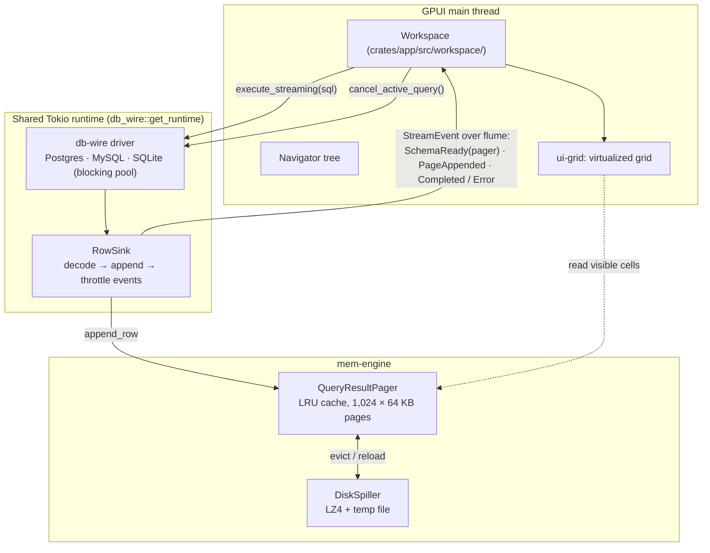

# Architecture

- Connection sessions own their provider, schema cache and metadata. Table/script tabs and asynchronous query/Save operations carry stable connection and tab identities, including the original cancellation driver.
- Script snapshots are written by one background queue using atomic replacement; cursor blinking and query progress update the result pane independently. Software Update is a separate GPUI entity with its own state and tasks.
- Every driver future runs on one shared multi-threaded Tokio runtime (`db_wire::run_on_shared_runtime`). Sockets and pool tasks therefore never depend on a short-lived caller runtime.
- A query produces an ordered event stream:
  1. `SchemaReady(pager)`: the driver owns the result pager and hands it to the UI.
  2. Throttled `PageAppended` batches, at most once per frame or on each page rollover.
  3. `Completed` or `Error`.
- The UI routes events to tabs by a stable tab id. While a query is running, a second run is refused rather than racing the cancel.

## Workspace crates

| Crate | Kind | Responsibility | State |
| :--- | :--- | :--- | :--- |
| `xtask` | developer tool | Native benchmark runner and regression checker (`cargo xtask`) | Used |
| `app` | binary | Window, workspace UI, connection management, query orchestration | Used |
| `platform-hal` | library | Paths, spill directory, Unix socket discovery, keychain, keymap helpers | Used |
| `mem-engine` | library | Slotted pages, LRU pager, LZ4 disk spill | Used |
| `db-wire` | library | Drivers, streaming, cancellation, CSV/SQL export, SSH (stub) | Used (SSH unused) |
| `sql-intel` | library | Tree-sitter SQL parsing, schema cache, completion | Used |
| `ui-core` | library | Theme and shared actions | Used |
| `ui-editor` | library | Rope buffer and SQL editor view | Used |
| `ui-grid` | library | Virtualized grid, selection, changeset | Used, including selection and editing |

## Memory engine

- Rows are stored in 64 KB slotted pages, with a null bitmap and a cell offset table per row for O(1) cell access.
- An LRU cache keeps up to 1,024 pages (~64 MB) in memory. Evicted pages are LZ4-compressed into a temporary spill file and paged back in on demand.
- The page currently being filled is shared copy-on-write, so reading it does not copy 64 KB per cell.
- Spill files go to `/var/tmp/fastdb` on Linux, to avoid a RAM-backed `/tmp`, and to `$TMPDIR/fastdb` on macOS.
