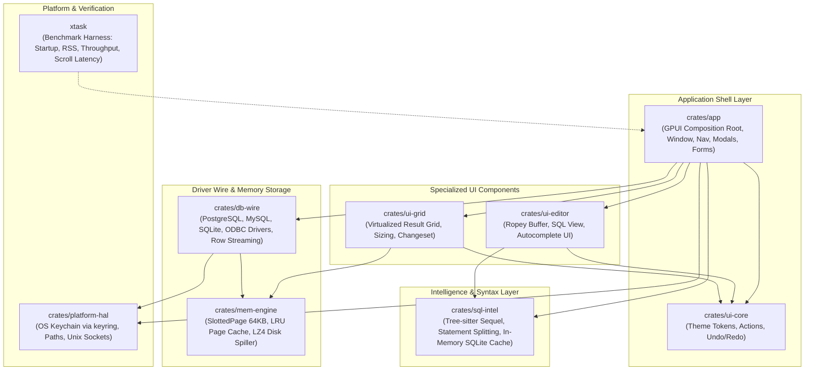
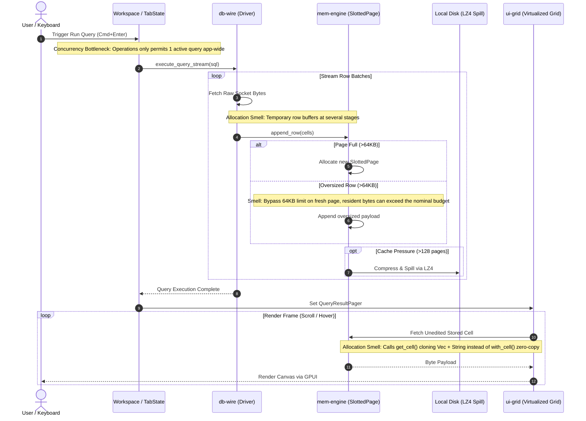
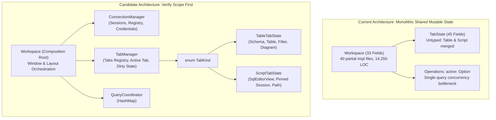

# Codebase Architecture, God Files, and Technical Debt Improvement Plan

Date: 2026-11-03  
Status: Triaged backlog. Section 5 distinguishes confirmed work from proposals that need evidence.

## 1. Goal

Address critical performance bottlenecks, architectural smells, and "god file" anti-patterns identified during the deep architectural audit. Preserve FastDB's lightweight native GPUI architecture while decoupling monolithic state, eliminating massive GUI element churn, securing data mutations, and removing redundant heap allocations.

---

## 2. Codebase Baseline & Structural Audit

### 2.1 Workspace Overview

As of 2026-11-03, the FastDB repository contains **152 Rust source files** and **40,569 lines of code** across 8 crates and the `xtask` benchmark automation runner:

| Crate / Directory | Files | LOC | Primary Responsibility |
| :--- | :---: | :---: | :--- |
| `crates/app` | 78 | 23,481 | Main executable, GPUI composition root, layout, dialogs, updater (**57.9%**) |
| `crates/db-wire` | 32 | 8,005 | Database driver abstraction (Postgres, MySQL, SQLite, ODBC), streaming sink |
| `crates/ui-editor` | 7 | 2,897 | SQL text editor (Ropey buffer, view, single-line input, autocomplete popup) |
| `crates/ui-grid` | 10 | 2,192 | Virtualized tabular result grid, column sizing, selection, changeset editing |
| `crates/sql-intel` | 6 | 1,428 | Tree-sitter SQL parsing, statement splitter, SQLite in-memory schema cache |
| `xtask` | 4 | 981 | Automation harness measuring startup, RSS, query throughput, scroll latency |
| `crates/mem-engine` | 6 | 888 | Slotted page storage (64KB), LRU buffer cache, LZ4 disk spilling |
| `crates/platform-hal` | 5 | 421 | OS paths, OS Keychain store (`keyring`), Unix socket auto-discovery |
| `crates/ui-core` | 4 | 276 | Shared actions, undo/redo history stack, theme tokens |
| **Total** | **152** | **40,569** | |

### 2.2 System Architecture & Crate Dependency Hierarchy

The following diagram illustrates the component layers, crate responsibilities, and directional dependencies across the workspace:

### 2.3 End-to-End Query Execution & Streaming Data Flow

This diagram traces the lifecycle of a query from execution trigger through memory-paging to virtualized grid rendering, highlighting the identified bottlenecks:

---

## 3. God Files and Structural Anti-Patterns

### 3.1 Struct `Workspace` (`crates/app/src/workspace/mod.rs` & 40 partial impl files)
- **Scale**: Struct `Workspace` contains **33 direct fields** and is implemented across **40 separate files** totaling **14,250 LOC**.
- **Smell**: Acts as a "Partial Mega-Class" where all 40 files share unfettered mutable access to `self.tabs`, `self.active_tab`, `self.form`, `self.connections`, and `self.operations`.
- **Issues**:
  - Lack of encapsulation: any component can mutate unrelated state without boundaries.
  - Blocking synchronous disk I/O occurs on the main UI thread during `Workspace::new` (`ConnectionRepository::load_saved_connections()` reads JSON before rendering frame 1).

### 3.2 Struct `TabState` (`crates/app/src/workspace/tab_state.rs`)
- **Scale**: Struct `TabState` holds **45 fields** in 1,072 LOC.
- **Smell**: Monolithic untyped tab representation combining two completely disjoint screens:
  - *Table View*: `schema_name`, `table_name`, `filter_sql`, `filter_timeline`, `active_subtab`, `active_property_section`, `diagram`.
  - *Script View*: `editor` (`SqlEditorView`), `script_path`, `saved_text`, `results`, `tab_session`, `pending_statements`.
- **Issues**:
  - Memory bloat: opening a Table Tab instantiates a full `SqlEditorView` with its Ropey buffer, tree-sitter parser, and autocomplete state.
  - Fragile heuristic identification: `is_script()` checks `self.column_editor.is_none() && self.table_name.is_none()`.

### 3.3 File `updater.rs` (`crates/app/src/updater.rs`)
- **Scale**: 1,199 LOC single file.
- **Smell**: Violates Single Responsibility Principle by combining GitHub REST API calls, semver parsing, file download streaming, deep OS shell automation (`hdiutil attach/detach`, `ditto`, `codesign`), and process respawning.
- **Security Issue**: Ad-hoc re-signs binaries (`codesign --force --deep --sign -`) without cryptographic signature verification (Minisign) or SHA256 checksum validation.

### 3.4 State Architecture: Current Monolith vs. Proposed Decoupled Model

The structural refactoring focuses on moving away from the "mega-class" pattern towards isolated domain managers and typed tab state:

---

## 4. Audit findings

**FIX** marks a concrete behavior visible in the current code. Capture a failing regression test or a performance baseline before changing it. **VERIFY FIRST** means collect the specified evidence or settle the product requirement before writing implementation code. A confirmed mechanism can still have an unmeasured impact.

| Finding | Decision | Evidence and scope |
| --- | --- | --- |
| 4.1 · Editor element count | FIX · P1-01 | In `ui-editor/src/editor_view.rs`, each rendered character gets a container and two cursor hit targets. A 4,000-character view therefore creates roughly 12,000 such elements. Measure typing latency separately. |
| 4.2 · SSH forwarding | FIX · P2-04 | `SshTunnel::start_forwarding` returns success and drops its listener without forwarding traffic. The README already describes SSH as unsupported. |
| 4.3 · Temporary row buffers | FIX · P2-01 | `stream.rs`, `pager.rs` and `slotted_page.rs` materialize intermediate vectors. Allocation counts depend on row contents and page rollover. Profile the count and cost on a fixed workload. |
| 4.4 · Oversized pages | FIX · P2-05 | An empty page accepts a row larger than 64 KiB. Eviction counts pages, so the configured page count cannot enforce the nominal byte budget. |
| 4.5 · Grid edit values | FIX · P2-02 | `sql.rs` formats values as SQL literals and uses lossy UTF-8 conversion for original row keys. Binary key identity can be lost. **VERIFY FIRST** for claims of exploitable injection or failures with JSON or timestamps. Record the provider, settings, input and observed result. |
| 4.6 · Unicode column sizing | VERIFY FIRST · P2-06 | `grid_element/widths.rs` uses font measurements where available and estimates the rest. Reproduce clipping with a specific font, value and sizing action. Check whether the estimate, sample limit or width cap determined the result. |
| 4.7 · Script parsing | VERIFY FIRST · P3-01 | Rejecting MySQL hash and executable comments is documented policy. A parser difference alone does not establish an execution defect. |
| 4.8 · ODBC cancellation | VERIFY FIRST · P2-07 | `SQLCancel` runs in `spawn_blocking`. Its mutex keeps the statement handle alive while the driver uses it. A blocked call alone does not establish a deadlock. |
| 4.9 · Grid and export copies | FIX · P2-03 | For fetched, unedited cells, `resolve_cell` copies pager bytes before constructing display text. The CSV and SQL serializers in `db-wire/src/export.rs` also call `get_cell`. Scroll latency and export throughput remain unmeasured. |

## 5. Phased implementation roadmap

### Phase 1 · Editor and tab ownership

- [ ] **P1-01 · FIX · Reduce per-character editor elements.** Record element count and typing latency on the same document and viewport before and after the change. Exercise cursor placement, selection and Unicode text when replacing per-character hit targets.
- [ ] **P1-02 · VERIFY FIRST · Concurrent queries across tabs.** The global operation limit is confirmed. Define which sessions may overlap and how cancellation targets one operation when tabs share a driver. Before enabling overlap, test same-connection cancellation, stale completion, save ownership and script cleanup.
- [ ] **P1-03 · VERIFY FIRST · Typed tab state.** Trace script, table and column-editor creation, close and dirty-state handling. Measure the cost of opening table tabs and identify which editor fields each tab needs before choosing enum variants.

### Phase 2 · Data pipeline and provider behavior

- [ ] **P2-01 · FIX · Reduce temporary row buffers.** Profile allocations and throughput on identical rows before and after. Preserve nullable cells with borrowed optional slices or a null bitmap. Test SQL NULL and empty bytes on both sides of a page rollover and after spill/reload.
- [ ] **P2-02 · FIX · Preserve typed grid edit values.** Reproduce a binary-key edit with invalid UTF-8 on a supporting provider. Carry original keys and typed values through the change set, SQL builder and driver execution boundary. Test NULL, binary and quoted values, and rollback when an edit affects other than one row. Agree the driver API change before implementation.
- [ ] **P2-03 · FIX · Remove intermediate pager copies.** Use `with_cell` where consumers can process bytes inside the callback. Keep ownership where GPUI requires it. Compare grid text and exported CSV/SQL bytes, including NULL, empty and edited cells where applicable. Measure scrolling and export separately.
- [ ] **P2-04 · FIX · Stop reporting a working SSH tunnel.** While forwarding is unsupported, make the stub return an explicit unsupported error and test that callers cannot receive a successful tunnel. Implementing SSH forwarding is a separate feature decision.
- [ ] **P2-05 · FIX · Account for resident page bytes.** Test multiple rows larger than 64 KiB under a small byte budget. Account for the active page as well as cached pages, define the allowance for a single oversized row, and verify eviction and byte-for-byte readback. Choose overflow storage only if needed to meet the bound.
- [ ] **P2-06 · VERIFY FIRST · Unicode column sizing.** Capture the clipping case described in 4.6 and compare the final width with the measured glyph width. Change sizing only if the reproduction identifies an incorrect width.
- [ ] **P2-07 · VERIFY FIRST · ODBC cancellation.** On a named driver and version, cancel a running statement under a bounded test timeout. Capture thread stacks if it hangs. Establish which calls wait on each other before changing statement-handle synchronization.

### Phase 3 · Architecture and updater verification

- [ ] **P3-01 · VERIFY FIRST · Script parser consolidation.** Identify a failing case within the documented execution policy or agree on a dialect change. Preserve transaction preflight, persistent-session rules and rejection of an invalid script before its first write. Evaluate Tree-sitter against those cases before retiring the lexer.
- [ ] **P3-02 · VERIFY FIRST · Autocomplete cache.** Measure lookup latency and lock wait with representative schema sizes during refresh. Consider a trie only if lookup or contention misses an agreed latency target.
- [ ] **P3-03 · VERIFY FIRST · Keyboard action routing.** Identify a concrete routing failure or an agreed keybinding requirement. Trace focus and shortcut precedence before migrating handlers.
- [ ] **P3-04 · VERIFY FIRST · Workspace decomposition.** Identify a state invariant that current ownership makes difficult to enforce. For the startup I/O concern, measure time to first frame with representative saved connections. Use those findings to scope the refactor.
- [ ] **P3-05 · FIX · Verify updates before opening or installing them.** Require published updates to include a signed checksum manifest. Verify its Minisign signature with the trusted key and match the selected artifact's SHA256 before every install or manual-open fallback. Test a valid release, missing or invalid signature, absent manifest entry and mismatched artifact.
